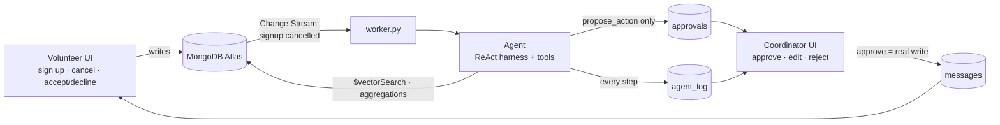

# VolunteerOps

**An AI agent for volunteer coordinators. The agent does the work; the coordinator stays in charge.**

<!-- TODO: demo GIF / screenshot -->

When a volunteer cancels, VolunteerOps notices right away through a MongoDB Change Stream. The agent finds the best available replacements with Atlas Vector Search, writes a short, friendly request for each one, and puts the proposal in front of the coordinator. Nothing reaches a volunteer until the coordinator clicks **Approve**.

---

## The problem

Volunteer coordinators at small nonprofits spend hours every week filling last-minute gaps. Someone cancels, and the coordinator has to dig through spreadsheets to see who is free, who can drive, and who hasn't been asked too often lately. Then they write a dozen individual texts. The work is repetitive, but the judgment is not: coordinators know their people, and they don't want a bot messaging volunteers on its own.

<!-- TODO: interview quote -->

## How it works



1. **Vacancy:** a volunteer cancels → Change Stream → the agent proposes 2–3 ranked replacements with drafted messages.
2. **Approve:** the coordinator ticks candidates, edits drafts if needed, and approves. Messages land in the volunteers' inboxes.
3. **Respond:** the volunteer accepts (in a transaction, so a shift can't be overfilled) or declines. If everyone declines, the agent is triggered again and skips the people who declined.
4. **Ask:** the coordinator types *"Need 2 more drivers for Saturday's pantry delivery"* and gets a drivers-only proposal.
5. **Coverage scan:** one click proposes invites for the top coverage gaps of the week.

## The coordinator stays in charge

- The agent has exactly **two write tools: `propose_action` and `log_note`**. It cannot sign anyone up or send anything.
- Every outreach is a **pending approval** that a human must approve. They can untick candidates, rewrite drafts, add a note, or reject.
- `propose_action` **rejects volunteer IDs the agent didn't get from a search tool in the same run**, so a hallucinated person can never be proposed. It also blocks already-confirmed volunteers, people who cancelled or declined that shift, more than 3 candidates, and drafts over 60 words.
- Every thought, tool call, and tool result is stored in **`agent_log`**. The "🔍 Why?" expander on each approval card shows the whole run.

## Why MongoDB

| Feature | What it does here | Where |
|---|---|---|
| **Flexible document model** | Nested availability blocks, skills arrays, and candidate lists (with reasons and drafts) embedded in each approval | `core/repo.py`, `agent/tools.py` (`propose_action`) |
| **Atlas Vector Search + filters** | `$vectorSearch` over bio embeddings with `filter: {can_drive, org}`, which does semantic fit and hard constraints in one query. Also matches shifts to a volunteer's bio for "Recommended for you". | `core/repo.py` (`vector_search_volunteers`, `vector_search_shifts`), index definitions in `core/db.py` |
| **Change Streams + resume tokens** | One stream wakes the agent on cancellations and decline re-triggers. No polling. The resume token is persisted, and events are claimed by unique key, so a restart neither misses nor duplicates work. | `worker.py` |
| **Aggregation pipelines** | `hours_28d` fairness score (`$lookup` + `$group`), coverage gaps, shift board, dashboard metrics | `core/repo.py` (`hours_28d`, `coverage_gaps`, `shift_board`, `dashboard_metrics`) |
| **Multi-document transactions** | Accepting a request inserts the signup, updates the message, refreshes the shift, and withdraws other pending requests atomically. Concurrent accepts can't overfill a shift. | `core/actions.py` (`accept_message`) |
| **Audit log** | Every agent step is a document, rendered as a timeline in the UI | `agent/harness.py`, `ui/coordinator_view.py` |

Fallbacks keep the demo alive: if the vector index isn't ready, search falls back to in-Python cosine similarity, and if change streams are unavailable, the worker polls every 3 s.

## Agent design

- **Hand-written ReAct harness** (`agent/harness.py`, about 100 lines, no agent framework). It runs up to 12 steps. Malformed arguments and unknown tools come back to the model as error strings, so the loop never crashes.
- **Deterministic code retrieves and filters; the LLM ranks, explains, and writes.**

| Tool | Purpose |
|---|---|
| `get_shift` | shift details, confirmed count, open slots |
| `get_coverage_gaps` | upcoming shifts with open slots (aggregation) |
| `find_candidates` | available, not-yet-signed-up volunteers ranked by vector similarity, with `hours_28d` |
| `search_volunteers` / `search_shifts` | free semantic search |
| `volunteer_history` | last 5 signups and recent hours |
| `propose_action` | queue a proposal for approval (validated) |
| `log_note` / `finish` | audit note / end run |

- **Fairness heuristic:** when fit is similar, the agent prefers volunteers with fewer hours in the last 28 days and says so in the reasons.
- **JSON-mode fallback:** if the endpoint rejects native `tools=`, `agent/llm.py` switches to a JSON protocol (`{"tool": ..., "args": ...}` / `{"final": ...}`). The harness code path doesn't change.

## Run it locally

Requirements: Python 3.11+, a MongoDB Atlas cluster (free M0 works), and an OpenAI-compatible LLM endpoint (we use Luminal).

```bash
python3 -m venv .venv && source .venv/bin/activate
pip install -r requirements.txt

cp .env.example .env              # then fill in MONGODB_URI and LLM_* values
python scripts/check_env.py       # checks Atlas, LLM, tool calling, embeddings
python scripts/reset_demo.py      # seeds demo data and creates indexes (incl. vector search)

python worker.py                  # terminal 1: change-stream listener
streamlit run app.py              # terminal 2: the app
```

If `reset_demo.py` can't create the vector search indexes automatically, it prints the JSON definitions to paste into **Atlas UI → Atlas Search → Create Search Index → JSON editor**.

## Demo script

1. `python scripts/reset_demo.py`. In the **Volunteer** view as **Alex Rivera**, cancel **Saturday Delivery Run**.
2. Switch to **Coordinator**. A 🚨 vacancy approval appears within seconds with no refresh. Open **🔍 Why?** to see the agent's steps.
3. Edit one draft, then **Approve selected** for 2 candidates.
4. **Volunteer** view as candidate #1. The request is in the inbox → **Accept** → toast.
5. **Coordinator**: the shift board shows the delivery run as 🟢 filled, and the activity feed is updated.
6. Ask the agent: *"Need 2 more drivers for Saturday's pantry delivery"*. The live status streams the steps, and the proposal contains drivers only.
7. **Volunteer** view as **Priya Natarajan** (bio mentions kids). **Kids Reading Hour** tops "Recommended".

## Built with

- **Luminal**: LLM inference (OpenAI-compatible API)
- **MongoDB Atlas**: Vector Search, Change Streams, aggregations, transactions
- **Streamlit**: UI
- **sentence-transformers** (`all-MiniLM-L6-v2`): local 384-dim embeddings

## Limitations and next steps

- Messages are in-app only. Real SMS/email delivery (e.g. Twilio) is next.
- No authentication. The volunteer picker is for demo purposes.
- Single organization. Multi-org support would scope every query and index filter by `org`.
- Learning from coordinator edits: use approved and rejected proposals and edited drafts to tune ranking and tone.
