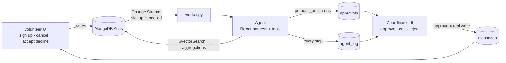

# VolunteerOps

**An AI agent for volunteer coordinators. The agent does the work; the coordinator stays in charge.**

<!-- TODO: demo GIF / screenshot -->

When a volunteer cancels, VolunteerOps notices right away through a MongoDB Change Stream. The agent finds the best available replacements with Atlas Vector Search, writes a short, friendly request for each one, and puts the proposal in front of the coordinator. Nothing reaches a volunteer until the coordinator clicks **Approve**.

---

## The problem

Volunteer coordinators at small nonprofits spend hours every week filling last-minute gaps. Someone cancels, and the coordinator has to dig through spreadsheets to see who is free, who can drive, and who hasn't been asked too often lately. Then they write a dozen individual texts. The work is repetitive, but the judgment is not: coordinators know their people, and they don't want a bot messaging volunteers on its own.

<!-- TODO: interview quote -->

## How it works



1. **Vacancy:** a volunteer cancels → Change Stream → the agent proposes 2–3 ranked replacements with drafted messages.
2. **Approve:** the coordinator ticks candidates, edits drafts if needed, and approves. Messages land in the volunteers' inboxes.
3. **Respond:** the volunteer accepts (in a transaction, so a shift can't be overfilled) or declines. If everyone declines, the agent is triggered again and skips the people who declined.
4. **Ask:** the coordinator types *"Need 2 more drivers for Saturday's pantry delivery"* and gets a drivers-only proposal.
5. **Coverage scan:** one click proposes invites for the top coverage gaps of the week.

## The coordinator stays in charge

- The agent has exactly **two write tools: `propose_action` and `log_note`**. It cannot sign anyone up or send anything.
- Every outreach is a **pending approval** that a human must approve. They can untick candidates, rewrite drafts, add a note, or reject.
- `propose_action` **rejects volunteer IDs the agent didn't get from a search tool in the same run**, so a hallucinated person can never be proposed. It also blocks already-confirmed volunteers, people who cancelled or declined that shift, more than 3 candidates, and drafts over 60 words.
- Every thought, tool call, and tool result is stored in **`agent_log`**. The "🔍 Why?" expander on each approval card shows the whole run.

## Email notifications

Approved requests are also emailed to volunteers, who can accept or decline straight from the email. Approved crew updates (e.g. a weather plan) are emailed as information-only notices. The agent never sends anything.

```
Coordinator approves ──▶ messages (+ delivery.email: queued)   ← outbox, written with the message
                                   │ change stream (insert)
                                   ▼
                              notifier.py ──▶ email provider ──▶ volunteer inbox
                                                                       │ signed link
                                                                       ▼
                        /?respond=<token> ──▶ Accept / Decline ──▶ actions.accept_message (transaction)
```

- **Outbox pattern.** `approve()` writes the email job onto the message document itself, so an approved request can't be lost if the provider is down. `notifier.py` delivers it.
- **Exactly-once claim.** Each email is claimed atomically (`queued → sending`), so two notifiers never double-send. Transient errors retry with exponential backoff (up to 5 attempts); permanent errors (bad credentials, refused recipient) are marked `failed`. The coordinator sees the email status per request on each shift page.
- **Signed, expiring response links.** Each email has an HMAC-signed link (default 7-day expiry). Opening it only shows the request; accepting takes an explicit click, so mail scanners that prefetch links can't respond for someone. Accepting goes through the same transaction as the in-app button.
- **Provider-agnostic.** `EMAIL_PROVIDER=console` (default) logs instead of sending. `smtp` works with any SMTP server, and `resend` uses the Resend API. There are no extra dependencies. Set `EMAIL_REDIRECT_TO` to route every email to one inbox for demos or staging.

| Variable | Purpose |
|---|---|
| `EMAIL_PROVIDER` | `console` (default), `smtp`, or `resend` |
| `EMAIL_FROM` | sender address |
| `EMAIL_REDIRECT_TO` | optional: send everything here instead of to volunteers |
| `APP_URL` | base URL for response links (default `http://localhost:8501`) |
| `RESPONSE_LINK_SECRET` | HMAC key for response links (required for real providers) |
| `SMTP_HOST` / `SMTP_PORT` / `SMTP_USER` / `SMTP_PASSWORD` | SMTP settings |
| `RESEND_API_KEY` | Resend settings |

## Why MongoDB

| Feature | What it does here | Where |
|---|---|---|
| **Flexible document model** | Nested availability blocks, skills arrays, and candidate lists (with reasons and drafts) embedded in each approval | `core/repo.py`, `agent/tools.py` (`propose_action`) |
| **Atlas Vector Search + filters** | `$vectorSearch` over bio embeddings with `filter: {can_drive, org}`, which does semantic fit and hard constraints in one query. Also matches shifts to a volunteer's bio for "Recommended for you". | `core/repo.py` (`vector_search_volunteers`, `vector_search_shifts`), index definitions in `core/db.py` |
| **Change Streams + resume tokens** | One stream wakes the agent on cancellations and decline re-triggers. No polling. The resume token is persisted, and events are claimed by unique key, so a restart neither misses nor duplicates work. A second stream wakes the email sender when a coordinator approves outreach. | `worker.py`, `notifier.py` |
| **Aggregation pipelines** | `hours_28d` fairness score (`$lookup` + `$group`), coverage gaps, shift board, dashboard metrics | `core/repo.py` (`hours_28d`, `coverage_gaps`, `shift_board`, `dashboard_metrics`) |
| **Multi-document transactions** | Accepting a request inserts the signup, updates the message, refreshes the shift, and withdraws other pending requests atomically. Concurrent accepts can't overfill a shift. | `core/actions.py` (`accept_message`) |
| **Audit log** | Every agent step is a document, rendered as a timeline in the UI | `agent/harness.py`, `ui/coordinator_view.py` |

Fallbacks keep the demo alive: if the vector index isn't ready, search falls back to in-Python cosine similarity, and if change streams are unavailable, the worker polls every 3 s.

## Agent design

- **Hand-written ReAct harness** (`agent/harness.py`, about 100 lines, no agent framework). It runs up to 12 steps. Malformed arguments and unknown tools come back to the model as error strings, so the loop never crashes.
- **Deterministic code retrieves and filters; the LLM ranks, explains, and writes.**

| Tool | Purpose |
|---|---|
| `get_shift` | shift details, confirmed count, open slots |
| `get_coverage_gaps` | upcoming shifts with open slots (aggregation) |
| `find_candidates` | available, not-yet-signed-up volunteers ranked by fit adjusted for recent workload, with `hours_28d` |
| `search_volunteers` / `search_shifts` | free semantic search |
| `volunteer_history` | last 5 signups and recent hours |
| `propose_action` | queue a proposal for approval (validated) |
| `log_note` / `finish` | audit note / end run |

- **Fairness heuristic:** candidates are ranked by `priority = match_score − 0.004 × hours_28d`, so 25 h of recent work costs about 0.1 of semantic fit. A clearly better fit still wins, but among similar fits the least-used volunteer comes first. The LLM picks who to propose and explains why; `propose_action` enforces the final order in code, so the ranking stays fair even if the model reshuffles it.
- **JSON-mode fallback:** if the endpoint rejects native `tools=`, `agent/llm.py` switches to a JSON protocol (`{"tool": ..., "args": ...}` / `{"final": ...}`). The harness code path doesn't change.

## Evaluation

We test the agent against a hand-crafted fixture where **every volunteer exists to test one rule**, so each scenario has a single correct answer. The fixture is defined in [`md/06_TEST_FIXTURES.md`](md/06_TEST_FIXTURES.md) and loaded by `scripts/load_fixtures.py` into a separate database. Every test volunteer is fictional.

- **Jordan**: ideal replacement (driver, free Saturday, 2 h recent). Should rank #1.
- **Priya**: good fit but 18 h recent. Should rank below Jordan, with fairness in her reasons.
- **Ethan**: perfect skills but available on Sunday only. Must never be proposed for Saturday.
- **Liam**: free from 11:00, shift starts 10:00 (partial overlap). Must be excluded.
- **Grace / Daniel**: already confirmed. Must be excluded.

LLM scenarios run 3 times each against the real model (DeepSeek-V4.1-Flash via Luminal), because model output varies between runs. Deterministic scenarios must pass every time.

| ID | Scenario | What it checks | Result | Avg time |
|---|---|---|---|---|
| T1 | Volunteer cancels → vacancy run | Jordan #1, exclusions, fairness reasons | ✅ 3/3 | 8.1 s |
| T2 | "Need 2 more drivers for Saturday's delivery run" | drivers only, available, exclusions | ⚠️ 2/3 | 14.8 s |
| T3 | Coverage scan, next 7 days | proposes the 3 open shifts, skips the full one | ✅ 3/3 | 15.6 s |
| T4 | All candidates decline → re-trigger | decliners excluded, no invented IDs | ✅ 3/3 | 47.5 s |
| T8 | "Need a Spanish speaker for Thursday's dinner" | Spanish speaker #1, confirmed volunteer excluded | ✅ 3/3 | 9.7 s |
| T5 | Two accepts race for one open slot | transaction: exactly 1 confirmed, other withdrawn | ✅ | — |
| T6 | `propose_action` with a random ID | blocked, no approval created | ✅ | — |
| T7 | Availability with partial overlap | timezone + window logic | ✅ | — |
| T9 | Recommendations for a kids-focused volunteer | Kids Reading Hour ranks #1 | ✅ | — |
| T10 | Malformed tool-call JSON | recoverable error string, no crash | ✅ | — |

**Summary:** deterministic 5/5, LLM 14/15 (93%). Across all 15 LLM runs:

- **0** rule violations: no unavailable, already-confirmed, cancelled, or declined volunteer was ever proposed.
- **0** invented volunteer IDs reached the approval queue.
- **3/3** runs ranked the low-hours volunteer above the overworked one.

**What didn't pass, and why:**

- **T2 (1 failure).** The delivery run in the fixture is already full. In one run, the agent declined to propose ("already fully staffed") instead of following the coordinator's explicit request for 2 more people. No rule was broken, but this is a judgment mismatch we plan to address in the prompt.
- **T4 latency.** When no drivers are left after everyone declines, the agent spends about 12 LLM calls before stopping, and ends without its own explanation (the harness fallback message is shown instead). Correct outcome, but slow and terse.
- **T3.** Each run hit one recoverable tool error, which the agent fixed on its own.

**Setup notes.** The fixture database uses the in-Python cosine fallback instead of `$vectorSearch`, because the free M0 cluster allows only 3 search indexes and the demo database already uses 2. With 12 volunteers this gives the same ranking. The fixture is small and purpose-built; it verifies rules and failure handling, not performance at scale.

Reproduce:

```bash
python scripts/run_scenarios.py                         # all scenarios, 3 runs per LLM scenario (~8 min)
python scripts/run_scenarios.py --runs 1 --only T1,T5   # quick subset
```

## Run it locally

Requirements: Python 3.11+, a MongoDB Atlas cluster (free M0 works), and an OpenAI-compatible LLM endpoint (we use Luminal).

```bash
python3 -m venv .venv && source .venv/bin/activate
pip install -r requirements.txt

cp .env.example .env              # then fill in MONGODB_URI and LLM_* values
python scripts/check_env.py       # checks Atlas, LLM, tool calling, embeddings
python scripts/reset_demo.py      # seeds demo data and creates indexes (incl. vector search)

python worker.py                  # terminal 1: change-stream listener (wakes the agent)
python notifier.py                # terminal 2: email outbox sender (optional)
streamlit run app.py              # terminal 3: the app
```

If `reset_demo.py` can't create the vector search indexes automatically, it prints the JSON definitions to paste into **Atlas UI → Atlas Search → Create Search Index → JSON editor**.

## Demo script

1. `python scripts/reset_demo.py`. In the **Volunteer** view as **Alex Rivera**, cancel **Saturday Delivery Run**.
2. Switch to **Coordinator**. A 🚨 vacancy approval appears within seconds with no refresh. Open **🔍 Why?** to see the agent's steps.
3. Edit one draft, then **Approve selected** for 2 candidates.
4. **Volunteer** view as candidate #1. The request is in the inbox → **Accept** → toast.
5. **Coordinator**: the shift board shows the delivery run as 🟢 filled, and the activity feed is updated.
6. Ask the agent: *"Need 2 more drivers for Saturday's pantry delivery"*. A new proposal appears in the queue, with drivers only.
7. **Volunteer** view as **Priya Natarajan** (bio mentions kids). **Kids Reading Hour** tops "Recommended".

## Built with

- **Luminal**: LLM inference (OpenAI-compatible API)
- **MongoDB Atlas**: Vector Search, Change Streams, aggregations, transactions
- **Streamlit**: UI
- **sentence-transformers** (`all-MiniLM-L6-v2`): local 384-dim embeddings

## Limitations and next steps

- Email is the only external channel. SMS (e.g. Twilio) and provider delivery/bounce webhooks are next.
- Response links point at the Streamlit app. A production deployment would serve them from a small API (e.g. FastAPI) behind a public domain with SPF/DKIM-verified sending.
- No authentication. The volunteer picker is for demo purposes.
- Single organization. Multi-org support would scope every query and index filter by `org`.
- Learning from coordinator edits: use approved and rejected proposals and edited drafts to tune ranking and tone.
